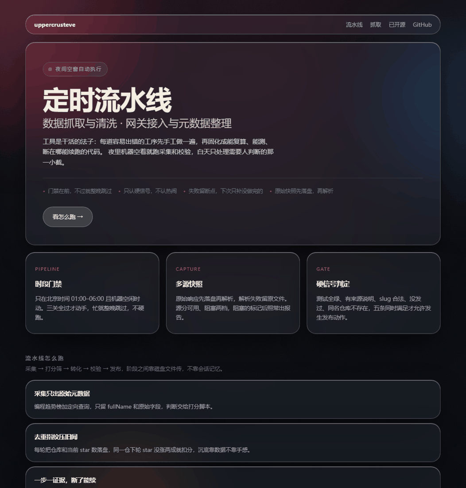

# liquid-glass-profile

一块能直接用的液态玻璃（liquid glass）个人主页模板。纯 HTML + CSS + 一小段指针脚本，没有构建、没有依赖、没有外网服务。

玻璃靠四层叠出来：模糊+饱和的背板、跟随指针的折射高光、一圈色散描边、按压时的弹性位移。底下有色斑在飘，玻璃才有东西可折射。



## 做什么

- 半透明玻璃卡：`backdrop-filter` 模糊加饱和，内嵌高光边和外投影
- 指针跟随：指针移动写入 CSS 变量，折射亮区跟着走；卡片有 3°/4px 以内的微倾
- 色散描边：135° 白→红→蓝渐变压在 1px 边线上，`mask-composite` 只留边
- 弹性位移：hover 用带过冲的三次贝塞尔，不弹跳过头
- 渐变背景色斑，26–38 秒反向漂移
- 降级：不支持 `backdrop-filter` 的浏览器退回深色实底；`prefers-reduced-motion` 关动画但保留高光
- 移动端单列，420px 以下收导航字号与内边距

## 怎么跑

直接开就行，或者起个本地服务：

```bash
python -m http.server 8000
# 打开 http://localhost:8000
```

放 GitHub Pages 也是一步：Settings → Pages → Source 选 `main` / root，仓库根已经有 `.nojekyll`。

## 怎么改成自己的

1. `index.html` 换文案和链接，标题、`<meta name="description">` 一起换
2. `assets/glass.css` 顶部 `:root` 里改主色 `--accent`、底色 `--bg`、圆角 `--radius`
3. 色斑颜色改 `.field .a / .b / .c` 的 `radial-gradient`
4. 不想要倾斜就删 `glass.js` 里 `if (!reduce)` 那一段

卡片和列表项的间距在 `.grid` / `ul.list`，改一处就够，不用动结构。

## 它不干什么

- **GitHub README 里贴不出这个效果**。README 会被剥掉 `<style>`，`backdrop-filter` 用不了。要玻璃就发 Pages 站，README 只放静态图或链接
- 不做滚动视差、不做页面转场、不做深浅主题切换，保持单页单主题
- 不依赖 `anuraghazra/github-readme-stats`、`shields.io` 一类的第三方服务，断网也完整
- 不写成组件库，没有构建链；需要 React 版就别用这个
- 图片全部本地，字体只用系统自带的黑体族

## 无障碍

- 导航、链接、按钮都有 `:focus-visible` 描边
- 交互不改变布局尺寸，指针移动只写 CSS 变量，不触发重排
- 主文字 `#F3ECE0` 压在玻璃深底上，正文对比度按 AA 打过
- 动画只走 `transform` / `opacity`；`prefers-reduced-motion` 下色斑和脉冲停止

## 静态玻璃图

`assets/hero-lens.svg` 是同一套视觉压进 SVG 的版本，给只能用 `` 的地方准备（比如 GitHub README，那里贴不了 CSS）。它用「底层色斑复制一份、重度模糊后裁进面板」来伪造折射，配一圈渐变亮边和 13 秒循环的扫光，纯 SMIL 动画，不需要脚本。

## 许可

MIT，见 `LICENSE`。

## 原创

液态玻璃这套视觉语言来自 Apple 2025 年的设计语言公开描述（半透明材质、镜面高光、边缘色散）。本仓的实现是自己搭的：没有用任何 glassmorphism 模板库、没有任何 CDN 资源，四层玻璃结构和降级策略从头写。指令来自一份 GitHub profile 美化教程用到的模块思路（徽章、统计卡、动效），落地方式不同——那类教程靠第三方服务挂图，这里是本地 CSS。
